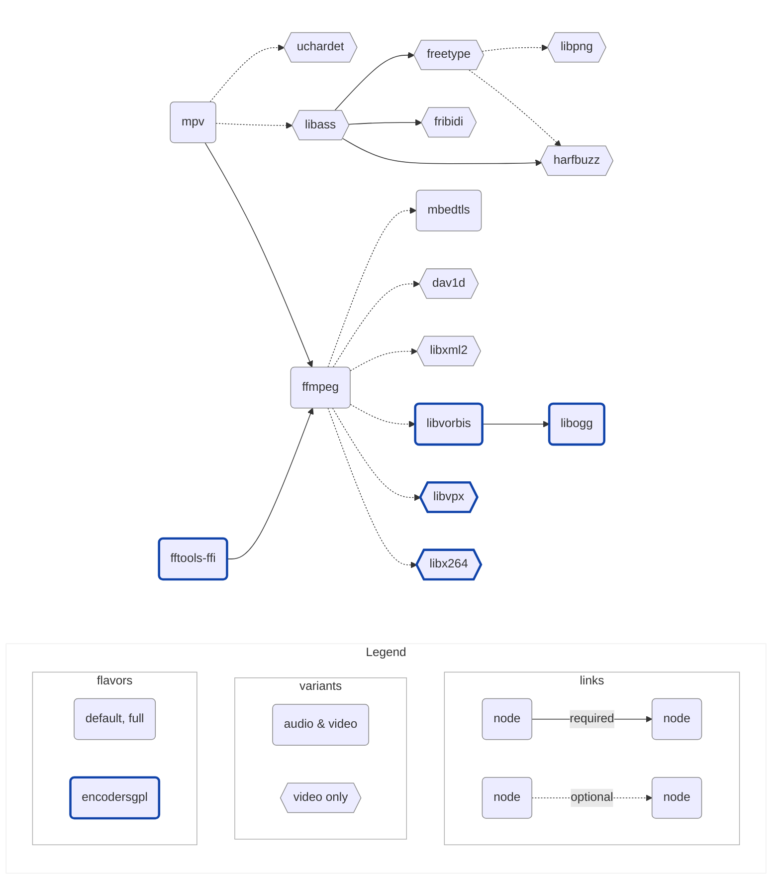

# libmpv build

Provides builds of [libmpv](https://github.com/mpv-player/mpv) for macOS & iOS,
used by [media_kit](https://github.com/alexmercerind/media_kit), compatible
with commercial use for playback, and GPL use for encoding.

Heavily inspired by [Homebrew](https://github.com/Homebrew/brew) and
[IINA](https://github.com/iina/iina).

## iOS-only release automation

The fork's `.github/workflows/mobile-release.yml` is manual-only. Dispatch it on
the exact commit to build, with a **new** `release_tag` such as
`v2.25.0-ios.1`; optional `request_id` (letters/digits/hyphens, at most 64) lets a
caller identify the run. Pushes and pull requests run standard-library tests
only. They do not compile Darwin libraries or publish releases.

The workflow builds the existing Nix target
`mk-out-archive-xcframeworks-ios-universal-video-full`. It does **not** build the
`mk-out-all` default. Nix evaluation confirms the payload consists of device
arm64 and universal simulator arm64/x86_64 frameworks. No macOS media libraries
are built. A shared macOS packaging shell may appear as a tiny shebang-patching
derivation; that shell is not executed for this target.

`macos-15` currently provides Xcode 16.1/16B40 according to the official
[runner image inventory](https://github.com/actions/runner-images/blob/main/images/macos/macos-15-Readme.md).
The workflow scans installed `Xcode*.app` bundles and checks the executable's
version/build plus device and simulator SDK availability; it never guesses an
application path, downloads Xcode, or silently switches the pinned SDK. An
installed iOS 18 runtime and iPhone 16 simulator device type are required for
the load check. Missing prerequisites stop before the Nix compilation.

Each successful run prepares 19 native assets:

- `libmpv-xcframeworks_<tag>_ios-universal-video-full.tar.gz`
- `libmpv-xcframeworks_<tag>_ios-universal-video-full_<Framework>.zip`
  for each of the 18 frameworks listed in `scripts/mobile_release.py`.

The additional `mobile-libmpv-manifest.json` records `schema_version: 1`,
`platform: "ios"`, repository, tag, the full dispatched source commit,
`workflow_run_id` (JSON integer), `request_id`, and the exact name, SHA-256,
size, kind and framework name of each asset. Consumers must verify these
fields and the associated successful workflow run before updating bindings.
The ZIP contents must equal the matching framework in the checked archive.

Before upload, checks inspect every slice's `Info.plist`, actual Mach-O
architectures and platform load commands, framework install names, dependency
closure, required mpv API exports, and undefined symbols. Flat-namespace
imports and unresolved `_pl_*` libplacebo symbols fail the build. The current
locked mpv 0.36.0 recipe deliberately builds without libplacebo; this release
pipeline does not stub missing symbols or change media dependency versions.
A small, freshly compiled iOS Simulator executable then `dlopen`s the **real**
Mpv framework with `RTLD_NOW`, resolves its public API, creates a player,
initializes `vo=null`/`ao=null`, and destroys it. Only the workflow's temporary
simulator is booted and removed. Static slice checks cover both simulator
architectures; execution covers the runner's native architecture. Actual
video rendering, hardware decoding, audio, subtitles and physical iOS devices
still need application integration tests.

Only the publishing job has `contents: write`. It rechecks all manifest hashes,
atomically creates a new tag at the dispatched SHA, creates a draft prerelease,
uploads without overwrite, verifies remote asset names/sizes/SHA-256 digests
and the exact asset set, rechecks the tag, then publishes the prerelease with
`make_latest: false`. Existing tags/releases are rejected before the expensive
build and again before publication. A race cannot force-update a tag. If an
upload fails, the new tag and draft remain for inspection and are never
silently replaced; use a new release tag after resolving the failure.

Local tooling checks (no native build):

```sh
python3 -m unittest discover -s tests -v
python3 -m py_compile scripts/mobile_release.py scripts/ios_load_smoke.py
nix eval --raw .#packages.aarch64-darwin.mk-out-archive-xcframeworks-ios-universal-video-full.name
nix eval --raw .#packages.x86_64-darwin.mk-out-archive-xcframeworks-ios-universal-video-full.name
```

The initial implementation was checked with these tests, workflow YAML parsing
and Nix target/dependency evaluation. No complete native compilation or paid
workflow dispatch was run locally. Fixture tests validate failure handling;
they are not evidence that the actual native artifact passes the CI gates.

## Setup

- Nix: [nixos.org/download/#nix-install-macos](https://nixos.org/download/#nix-install-macos)
- Xcode: [./nix/overlays/xcode.nix](./nix/overlays/xcode.nix)

> [!NOTE]
> If you plan to use Nix only temporarily, prefer the
> [Determinate Systems installer](https://github.com/DeterminateSystems/nix-installer)
> which ships a built-in uninstaller, unlike the official one.

## Build

```shell
$ nix develop -c make VERSION=v0.0.1
$ tree result
```

<details>
<summary>result</summary>

```shell
├── libmpv-libs_v0.0.1_ios-arm64-audio-default.tar.gz
├── libmpv-libs_v0.0.1_ios-arm64-audio-encodersgpl.tar.gz
├── libmpv-libs_v0.0.1_ios-arm64-audio-full.tar.gz
├── libmpv-libs_v0.0.1_ios-arm64-video-default.tar.gz
├── libmpv-libs_v0.0.1_ios-arm64-video-encodersgpl.tar.gz
├── libmpv-libs_v0.0.1_ios-arm64-video-full.tar.gz
├── libmpv-libs_v0.0.1_iossimulator-amd64-audio-default.tar.gz
├── libmpv-libs_v0.0.1_iossimulator-amd64-audio-encodersgpl.tar.gz
├── libmpv-libs_v0.0.1_iossimulator-amd64-audio-full.tar.gz
├── libmpv-libs_v0.0.1_iossimulator-amd64-video-default.tar.gz
├── libmpv-libs_v0.0.1_iossimulator-amd64-video-encodersgpl.tar.gz
├── libmpv-libs_v0.0.1_iossimulator-amd64-video-full.tar.gz
├── libmpv-libs_v0.0.1_iossimulator-arm64-audio-default.tar.gz
├── libmpv-libs_v0.0.1_iossimulator-arm64-audio-encodersgpl.tar.gz
├── libmpv-libs_v0.0.1_iossimulator-arm64-audio-full.tar.gz
├── libmpv-libs_v0.0.1_iossimulator-arm64-video-default.tar.gz
├── libmpv-libs_v0.0.1_iossimulator-arm64-video-encodersgpl.tar.gz
├── libmpv-libs_v0.0.1_iossimulator-arm64-video-full.tar.gz
├── libmpv-libs_v0.0.1_iossimulator-universal-audio-default.tar.gz
├── libmpv-libs_v0.0.1_iossimulator-universal-audio-encodersgpl.tar.gz
├── libmpv-libs_v0.0.1_iossimulator-universal-audio-full.tar.gz
├── libmpv-libs_v0.0.1_iossimulator-universal-video-default.tar.gz
├── libmpv-libs_v0.0.1_iossimulator-universal-video-encodersgpl.tar.gz
├── libmpv-libs_v0.0.1_iossimulator-universal-video-full.tar.gz
├── libmpv-libs_v0.0.1_macos-amd64-audio-default.tar.gz
├── libmpv-libs_v0.0.1_macos-amd64-audio-encodersgpl.tar.gz
├── libmpv-libs_v0.0.1_macos-amd64-audio-full.tar.gz
├── libmpv-libs_v0.0.1_macos-amd64-video-default.tar.gz
├── libmpv-libs_v0.0.1_macos-amd64-video-encodersgpl.tar.gz
├── libmpv-libs_v0.0.1_macos-amd64-video-full.tar.gz
├── libmpv-libs_v0.0.1_macos-arm64-audio-default.tar.gz
├── libmpv-libs_v0.0.1_macos-arm64-audio-encodersgpl.tar.gz
├── libmpv-libs_v0.0.1_macos-arm64-audio-full.tar.gz
├── libmpv-libs_v0.0.1_macos-arm64-video-default.tar.gz
├── libmpv-libs_v0.0.1_macos-arm64-video-encodersgpl.tar.gz
├── libmpv-libs_v0.0.1_macos-arm64-video-full.tar.gz
├── libmpv-libs_v0.0.1_macos-universal-audio-default.tar.gz
├── libmpv-libs_v0.0.1_macos-universal-audio-encodersgpl.tar.gz
├── libmpv-libs_v0.0.1_macos-universal-audio-full.tar.gz
├── libmpv-libs_v0.0.1_macos-universal-video-default.tar.gz
├── libmpv-libs_v0.0.1_macos-universal-video-encodersgpl.tar.gz
├── libmpv-libs_v0.0.1_macos-universal-video-full.tar.gz
├── libmpv-xcframeworks_v0.0.1_ios-universal-audio-default.tar.gz
├── libmpv-xcframeworks_v0.0.1_ios-universal-audio-default_Avcodec.zip
├── libmpv-xcframeworks_v0.0.1_ios-universal-audio-default_Avfilter.zip
├── libmpv-xcframeworks_v0.0.1_ios-universal-audio-default_Avformat.zip
├── libmpv-xcframeworks_v0.0.1_ios-universal-audio-default_Avutil.zip
├── libmpv-xcframeworks_v0.0.1_ios-universal-audio-default_Mbedcrypto.zip
├── libmpv-xcframeworks_v0.0.1_ios-universal-audio-default_Mbedtls.zip
├── libmpv-xcframeworks_v0.0.1_ios-universal-audio-default_Mbedx509.zip
├── libmpv-xcframeworks_v0.0.1_ios-universal-audio-default_Mpv.zip
├── libmpv-xcframeworks_v0.0.1_ios-universal-audio-default_Swresample.zip
├── libmpv-xcframeworks_v0.0.1_ios-universal-audio-default_Swscale.zip
├── libmpv-xcframeworks_v0.0.1_ios-universal-audio-encodersgpl.tar.gz
├── libmpv-xcframeworks_v0.0.1_ios-universal-audio-encodersgpl_Avcodec.zip
├── libmpv-xcframeworks_v0.0.1_ios-universal-audio-encodersgpl_Avfilter.zip
├── libmpv-xcframeworks_v0.0.1_ios-universal-audio-encodersgpl_Avformat.zip
├── libmpv-xcframeworks_v0.0.1_ios-universal-audio-encodersgpl_Avutil.zip
├── libmpv-xcframeworks_v0.0.1_ios-universal-audio-encodersgpl_Fftools-ffi.zip
├── libmpv-xcframeworks_v0.0.1_ios-universal-audio-encodersgpl_Mbedcrypto.zip
├── libmpv-xcframeworks_v0.0.1_ios-universal-audio-encodersgpl_Mbedtls.zip
├── libmpv-xcframeworks_v0.0.1_ios-universal-audio-encodersgpl_Mbedx509.zip
├── libmpv-xcframeworks_v0.0.1_ios-universal-audio-encodersgpl_Mpv.zip
├── libmpv-xcframeworks_v0.0.1_ios-universal-audio-encodersgpl_Ogg.zip
├── libmpv-xcframeworks_v0.0.1_ios-universal-audio-encodersgpl_Swresample.zip
├── libmpv-xcframeworks_v0.0.1_ios-universal-audio-encodersgpl_Swscale.zip
├── libmpv-xcframeworks_v0.0.1_ios-universal-audio-encodersgpl_Vorbis.zip
├── libmpv-xcframeworks_v0.0.1_ios-universal-audio-encodersgpl_Vorbisenc.zip
├── libmpv-xcframeworks_v0.0.1_ios-universal-audio-encodersgpl_Vorbisfile.zip
├── libmpv-xcframeworks_v0.0.1_ios-universal-audio-full.tar.gz
├── libmpv-xcframeworks_v0.0.1_ios-universal-audio-full_Avcodec.zip
├── libmpv-xcframeworks_v0.0.1_ios-universal-audio-full_Avfilter.zip
├── libmpv-xcframeworks_v0.0.1_ios-universal-audio-full_Avformat.zip
├── libmpv-xcframeworks_v0.0.1_ios-universal-audio-full_Avutil.zip
├── libmpv-xcframeworks_v0.0.1_ios-universal-audio-full_Mbedcrypto.zip
├── libmpv-xcframeworks_v0.0.1_ios-universal-audio-full_Mbedtls.zip
├── libmpv-xcframeworks_v0.0.1_ios-universal-audio-full_Mbedx509.zip
├── libmpv-xcframeworks_v0.0.1_ios-universal-audio-full_Mpv.zip
├── libmpv-xcframeworks_v0.0.1_ios-universal-audio-full_Swresample.zip
├── libmpv-xcframeworks_v0.0.1_ios-universal-audio-full_Swscale.zip
├── libmpv-xcframeworks_v0.0.1_ios-universal-video-default.tar.gz
├── libmpv-xcframeworks_v0.0.1_ios-universal-video-default_Ass.zip
├── libmpv-xcframeworks_v0.0.1_ios-universal-video-default_Avcodec.zip
├── libmpv-xcframeworks_v0.0.1_ios-universal-video-default_Avfilter.zip
├── libmpv-xcframeworks_v0.0.1_ios-universal-video-default_Avformat.zip
├── libmpv-xcframeworks_v0.0.1_ios-universal-video-default_Avutil.zip
├── libmpv-xcframeworks_v0.0.1_ios-universal-video-default_Dav1d.zip
├── libmpv-xcframeworks_v0.0.1_ios-universal-video-default_Freetype.zip
├── libmpv-xcframeworks_v0.0.1_ios-universal-video-default_Fribidi.zip
├── libmpv-xcframeworks_v0.0.1_ios-universal-video-default_Harfbuzz.zip
├── libmpv-xcframeworks_v0.0.1_ios-universal-video-default_Mbedcrypto.zip
├── libmpv-xcframeworks_v0.0.1_ios-universal-video-default_Mbedtls.zip
├── libmpv-xcframeworks_v0.0.1_ios-universal-video-default_Mbedx509.zip
├── libmpv-xcframeworks_v0.0.1_ios-universal-video-default_Mpv.zip
├── libmpv-xcframeworks_v0.0.1_ios-universal-video-default_Png16.zip
├── libmpv-xcframeworks_v0.0.1_ios-universal-video-default_Swresample.zip
├── libmpv-xcframeworks_v0.0.1_ios-universal-video-default_Swscale.zip
├── libmpv-xcframeworks_v0.0.1_ios-universal-video-default_Uchardet.zip
├── libmpv-xcframeworks_v0.0.1_ios-universal-video-default_Xml2.zip
├── libmpv-xcframeworks_v0.0.1_ios-universal-video-encodersgpl.tar.gz
├── libmpv-xcframeworks_v0.0.1_ios-universal-video-encodersgpl_Ass.zip
├── libmpv-xcframeworks_v0.0.1_ios-universal-video-encodersgpl_Avcodec.zip
├── libmpv-xcframeworks_v0.0.1_ios-universal-video-encodersgpl_Avfilter.zip
├── libmpv-xcframeworks_v0.0.1_ios-universal-video-encodersgpl_Avformat.zip
├── libmpv-xcframeworks_v0.0.1_ios-universal-video-encodersgpl_Avutil.zip
├── libmpv-xcframeworks_v0.0.1_ios-universal-video-encodersgpl_Dav1d.zip
├── libmpv-xcframeworks_v0.0.1_ios-universal-video-encodersgpl_Fftools-ffi.zip
├── libmpv-xcframeworks_v0.0.1_ios-universal-video-encodersgpl_Freetype.zip
├── libmpv-xcframeworks_v0.0.1_ios-universal-video-encodersgpl_Fribidi.zip
├── libmpv-xcframeworks_v0.0.1_ios-universal-video-encodersgpl_Harfbuzz.zip
├── libmpv-xcframeworks_v0.0.1_ios-universal-video-encodersgpl_Mbedcrypto.zip
├── libmpv-xcframeworks_v0.0.1_ios-universal-video-encodersgpl_Mbedtls.zip
├── libmpv-xcframeworks_v0.0.1_ios-universal-video-encodersgpl_Mbedx509.zip
├── libmpv-xcframeworks_v0.0.1_ios-universal-video-encodersgpl_Mpv.zip
├── libmpv-xcframeworks_v0.0.1_ios-universal-video-encodersgpl_Ogg.zip
├── libmpv-xcframeworks_v0.0.1_ios-universal-video-encodersgpl_Png16.zip
├── libmpv-xcframeworks_v0.0.1_ios-universal-video-encodersgpl_Swresample.zip
├── libmpv-xcframeworks_v0.0.1_ios-universal-video-encodersgpl_Swscale.zip
├── libmpv-xcframeworks_v0.0.1_ios-universal-video-encodersgpl_Uchardet.zip
├── libmpv-xcframeworks_v0.0.1_ios-universal-video-encodersgpl_Vorbis.zip
├── libmpv-xcframeworks_v0.0.1_ios-universal-video-encodersgpl_Vorbisenc.zip
├── libmpv-xcframeworks_v0.0.1_ios-universal-video-encodersgpl_Vorbisfile.zip
├── libmpv-xcframeworks_v0.0.1_ios-universal-video-encodersgpl_Vpx.zip
├── libmpv-xcframeworks_v0.0.1_ios-universal-video-encodersgpl_X264.zip
├── libmpv-xcframeworks_v0.0.1_ios-universal-video-encodersgpl_Xml2.zip
├── libmpv-xcframeworks_v0.0.1_ios-universal-video-full.tar.gz
├── libmpv-xcframeworks_v0.0.1_ios-universal-video-full_Ass.zip
├── libmpv-xcframeworks_v0.0.1_ios-universal-video-full_Avcodec.zip
├── libmpv-xcframeworks_v0.0.1_ios-universal-video-full_Avfilter.zip
├── libmpv-xcframeworks_v0.0.1_ios-universal-video-full_Avformat.zip
├── libmpv-xcframeworks_v0.0.1_ios-universal-video-full_Avutil.zip
├── libmpv-xcframeworks_v0.0.1_ios-universal-video-full_Dav1d.zip
├── libmpv-xcframeworks_v0.0.1_ios-universal-video-full_Freetype.zip
├── libmpv-xcframeworks_v0.0.1_ios-universal-video-full_Fribidi.zip
├── libmpv-xcframeworks_v0.0.1_ios-universal-video-full_Harfbuzz.zip
├── libmpv-xcframeworks_v0.0.1_ios-universal-video-full_Mbedcrypto.zip
├── libmpv-xcframeworks_v0.0.1_ios-universal-video-full_Mbedtls.zip
├── libmpv-xcframeworks_v0.0.1_ios-universal-video-full_Mbedx509.zip
├── libmpv-xcframeworks_v0.0.1_ios-universal-video-full_Mpv.zip
├── libmpv-xcframeworks_v0.0.1_ios-universal-video-full_Png16.zip
├── libmpv-xcframeworks_v0.0.1_ios-universal-video-full_Swresample.zip
├── libmpv-xcframeworks_v0.0.1_ios-universal-video-full_Swscale.zip
├── libmpv-xcframeworks_v0.0.1_ios-universal-video-full_Uchardet.zip
├── libmpv-xcframeworks_v0.0.1_ios-universal-video-full_Xml2.zip
├── libmpv-xcframeworks_v0.0.1_macos-universal-audio-default.tar.gz
├── libmpv-xcframeworks_v0.0.1_macos-universal-audio-default_Avcodec.zip
├── libmpv-xcframeworks_v0.0.1_macos-universal-audio-default_Avfilter.zip
├── libmpv-xcframeworks_v0.0.1_macos-universal-audio-default_Avformat.zip
├── libmpv-xcframeworks_v0.0.1_macos-universal-audio-default_Avutil.zip
├── libmpv-xcframeworks_v0.0.1_macos-universal-audio-default_Mbedcrypto.zip
├── libmpv-xcframeworks_v0.0.1_macos-universal-audio-default_Mbedtls.zip
├── libmpv-xcframeworks_v0.0.1_macos-universal-audio-default_Mbedx509.zip
├── libmpv-xcframeworks_v0.0.1_macos-universal-audio-default_Mpv.zip
├── libmpv-xcframeworks_v0.0.1_macos-universal-audio-default_Swresample.zip
├── libmpv-xcframeworks_v0.0.1_macos-universal-audio-default_Swscale.zip
├── libmpv-xcframeworks_v0.0.1_macos-universal-audio-encodersgpl.tar.gz
├── libmpv-xcframeworks_v0.0.1_macos-universal-audio-encodersgpl_Avcodec.zip
├── libmpv-xcframeworks_v0.0.1_macos-universal-audio-encodersgpl_Avfilter.zip
├── libmpv-xcframeworks_v0.0.1_macos-universal-audio-encodersgpl_Avformat.zip
├── libmpv-xcframeworks_v0.0.1_macos-universal-audio-encodersgpl_Avutil.zip
├── libmpv-xcframeworks_v0.0.1_macos-universal-audio-encodersgpl_Fftools-ffi.zip
├── libmpv-xcframeworks_v0.0.1_macos-universal-audio-encodersgpl_Mbedcrypto.zip
├── libmpv-xcframeworks_v0.0.1_macos-universal-audio-encodersgpl_Mbedtls.zip
├── libmpv-xcframeworks_v0.0.1_macos-universal-audio-encodersgpl_Mbedx509.zip
├── libmpv-xcframeworks_v0.0.1_macos-universal-audio-encodersgpl_Mpv.zip
├── libmpv-xcframeworks_v0.0.1_macos-universal-audio-encodersgpl_Ogg.zip
├── libmpv-xcframeworks_v0.0.1_macos-universal-audio-encodersgpl_Swresample.zip
├── libmpv-xcframeworks_v0.0.1_macos-universal-audio-encodersgpl_Swscale.zip
├── libmpv-xcframeworks_v0.0.1_macos-universal-audio-encodersgpl_Vorbis.zip
├── libmpv-xcframeworks_v0.0.1_macos-universal-audio-encodersgpl_Vorbisenc.zip
├── libmpv-xcframeworks_v0.0.1_macos-universal-audio-encodersgpl_Vorbisfile.zip
├── libmpv-xcframeworks_v0.0.1_macos-universal-audio-full.tar.gz
├── libmpv-xcframeworks_v0.0.1_macos-universal-audio-full_Avcodec.zip
├── libmpv-xcframeworks_v0.0.1_macos-universal-audio-full_Avfilter.zip
├── libmpv-xcframeworks_v0.0.1_macos-universal-audio-full_Avformat.zip
├── libmpv-xcframeworks_v0.0.1_macos-universal-audio-full_Avutil.zip
├── libmpv-xcframeworks_v0.0.1_macos-universal-audio-full_Mbedcrypto.zip
├── libmpv-xcframeworks_v0.0.1_macos-universal-audio-full_Mbedtls.zip
├── libmpv-xcframeworks_v0.0.1_macos-universal-audio-full_Mbedx509.zip
├── libmpv-xcframeworks_v0.0.1_macos-universal-audio-full_Mpv.zip
├── libmpv-xcframeworks_v0.0.1_macos-universal-audio-full_Swresample.zip
├── libmpv-xcframeworks_v0.0.1_macos-universal-audio-full_Swscale.zip
├── libmpv-xcframeworks_v0.0.1_macos-universal-video-default.tar.gz
├── libmpv-xcframeworks_v0.0.1_macos-universal-video-default_Ass.zip
├── libmpv-xcframeworks_v0.0.1_macos-universal-video-default_Avcodec.zip
├── libmpv-xcframeworks_v0.0.1_macos-universal-video-default_Avfilter.zip
├── libmpv-xcframeworks_v0.0.1_macos-universal-video-default_Avformat.zip
├── libmpv-xcframeworks_v0.0.1_macos-universal-video-default_Avutil.zip
├── libmpv-xcframeworks_v0.0.1_macos-universal-video-default_Dav1d.zip
├── libmpv-xcframeworks_v0.0.1_macos-universal-video-default_Freetype.zip
├── libmpv-xcframeworks_v0.0.1_macos-universal-video-default_Fribidi.zip
├── libmpv-xcframeworks_v0.0.1_macos-universal-video-default_Harfbuzz.zip
├── libmpv-xcframeworks_v0.0.1_macos-universal-video-default_Mbedcrypto.zip
├── libmpv-xcframeworks_v0.0.1_macos-universal-video-default_Mbedtls.zip
├── libmpv-xcframeworks_v0.0.1_macos-universal-video-default_Mbedx509.zip
├── libmpv-xcframeworks_v0.0.1_macos-universal-video-default_Mpv.zip
├── libmpv-xcframeworks_v0.0.1_macos-universal-video-default_Png16.zip
├── libmpv-xcframeworks_v0.0.1_macos-universal-video-default_Swresample.zip
├── libmpv-xcframeworks_v0.0.1_macos-universal-video-default_Swscale.zip
├── libmpv-xcframeworks_v0.0.1_macos-universal-video-default_Uchardet.zip
├── libmpv-xcframeworks_v0.0.1_macos-universal-video-default_Xml2.zip
├── libmpv-xcframeworks_v0.0.1_macos-universal-video-encodersgpl.tar.gz
├── libmpv-xcframeworks_v0.0.1_macos-universal-video-encodersgpl_Ass.zip
├── libmpv-xcframeworks_v0.0.1_macos-universal-video-encodersgpl_Avcodec.zip
├── libmpv-xcframeworks_v0.0.1_macos-universal-video-encodersgpl_Avfilter.zip
├── libmpv-xcframeworks_v0.0.1_macos-universal-video-encodersgpl_Avformat.zip
├── libmpv-xcframeworks_v0.0.1_macos-universal-video-encodersgpl_Avutil.zip
├── libmpv-xcframeworks_v0.0.1_macos-universal-video-encodersgpl_Dav1d.zip
├── libmpv-xcframeworks_v0.0.1_macos-universal-video-encodersgpl_Fftools-ffi.zip
├── libmpv-xcframeworks_v0.0.1_macos-universal-video-encodersgpl_Freetype.zip
├── libmpv-xcframeworks_v0.0.1_macos-universal-video-encodersgpl_Fribidi.zip
├── libmpv-xcframeworks_v0.0.1_macos-universal-video-encodersgpl_Harfbuzz.zip
├── libmpv-xcframeworks_v0.0.1_macos-universal-video-encodersgpl_Mbedcrypto.zip
├── libmpv-xcframeworks_v0.0.1_macos-universal-video-encodersgpl_Mbedtls.zip
├── libmpv-xcframeworks_v0.0.1_macos-universal-video-encodersgpl_Mbedx509.zip
├── libmpv-xcframeworks_v0.0.1_macos-universal-video-encodersgpl_Mpv.zip
├── libmpv-xcframeworks_v0.0.1_macos-universal-video-encodersgpl_Ogg.zip
├── libmpv-xcframeworks_v0.0.1_macos-universal-video-encodersgpl_Png16.zip
├── libmpv-xcframeworks_v0.0.1_macos-universal-video-encodersgpl_Swresample.zip
├── libmpv-xcframeworks_v0.0.1_macos-universal-video-encodersgpl_Swscale.zip
├── libmpv-xcframeworks_v0.0.1_macos-universal-video-encodersgpl_Uchardet.zip
├── libmpv-xcframeworks_v0.0.1_macos-universal-video-encodersgpl_Vorbis.zip
├── libmpv-xcframeworks_v0.0.1_macos-universal-video-encodersgpl_Vorbisenc.zip
├── libmpv-xcframeworks_v0.0.1_macos-universal-video-encodersgpl_Vorbisfile.zip
├── libmpv-xcframeworks_v0.0.1_macos-universal-video-encodersgpl_Vpx.zip
├── libmpv-xcframeworks_v0.0.1_macos-universal-video-encodersgpl_X264.zip
├── libmpv-xcframeworks_v0.0.1_macos-universal-video-encodersgpl_Xml2.zip
├── libmpv-xcframeworks_v0.0.1_macos-universal-video-full.tar.gz
├── libmpv-xcframeworks_v0.0.1_macos-universal-video-full_Ass.zip
├── libmpv-xcframeworks_v0.0.1_macos-universal-video-full_Avcodec.zip
├── libmpv-xcframeworks_v0.0.1_macos-universal-video-full_Avfilter.zip
├── libmpv-xcframeworks_v0.0.1_macos-universal-video-full_Avformat.zip
├── libmpv-xcframeworks_v0.0.1_macos-universal-video-full_Avutil.zip
├── libmpv-xcframeworks_v0.0.1_macos-universal-video-full_Dav1d.zip
├── libmpv-xcframeworks_v0.0.1_macos-universal-video-full_Freetype.zip
├── libmpv-xcframeworks_v0.0.1_macos-universal-video-full_Fribidi.zip
├── libmpv-xcframeworks_v0.0.1_macos-universal-video-full_Harfbuzz.zip
├── libmpv-xcframeworks_v0.0.1_macos-universal-video-full_Mbedcrypto.zip
├── libmpv-xcframeworks_v0.0.1_macos-universal-video-full_Mbedtls.zip
├── libmpv-xcframeworks_v0.0.1_macos-universal-video-full_Mbedx509.zip
├── libmpv-xcframeworks_v0.0.1_macos-universal-video-full_Mpv.zip
├── libmpv-xcframeworks_v0.0.1_macos-universal-video-full_Png16.zip
├── libmpv-xcframeworks_v0.0.1_macos-universal-video-full_Swresample.zip
├── libmpv-xcframeworks_v0.0.1_macos-universal-video-full_Swscale.zip
├── libmpv-xcframeworks_v0.0.1_macos-universal-video-full_Uchardet.zip
└── libmpv-xcframeworks_v0.0.1_macos-universal-video-full_Xml2.zip
```

</details>

## Build a specific target

```shell
$ nix flake show
$ nix develop -c make TARGET=mk-out-archive-libs-macos-universal-video-default
$ tree result
```

## Naming convention

```
libmpv-<format>_<version>_<os>-<arch>-<variant>-<flavor>[_<framework>].<extension>
```

| Component     | Notes                                     | Value                      |
| ------------- | ----------------------------------------- | -------------------------- |
| **format**    | Output format of built files              | libs, xcframeworks         |
| **version**   | Semantic version                          | v0.0.1, …                  |
| **os**        | Operating system                          | ios, iossimulator, macos   |
| **arch**      | Architecture                              | arm64, amd64, universal    |
| **variant**   | Usage context                             | audio, video               |
| **flavor**    | Available decoders and encoders           | default, full, encodersgpl |
| **framework** | SwiftPM binary target artifact (optional) | Mpv, Avcodec, Avformat, …  |
| **extension** | Packaging format                          | tar.gz, zip                |

Inclusion:

- Variants: $audio \subset video$
- Flavors: $audio \subset full \subset encodersgpl$

## Minimum versions

<table>
  <thead>
    <tr>
      <th>Platform</th>
      <th>Arch</th>
      <th>Min Version</th>
      <th>Notes</th>
    </tr>
  </thead>
  <tbody>
    <tr>
      <td rowspan="2"><strong>macOS</strong></td>
      <td>amd64</td>
      <td rowspan="2"><code>10.9</code></td>
      <td rowspan="2">Required by <code>uchardet</code></td>
    </tr>
    <tr>
      <td>arm64</td>
    </tr>
    <tr>
      <td><strong>iOS</strong></td>
      <td>arm64</td>
      <td><code>9.0</code></td>
      <td>Required by <code>ffmpeg</code></td>
    </tr>
    <tr>
      <td rowspan="2"><strong>iOS Simulator</strong></td>
      <td>amd64</td>
      <td><code>9.0</code></td>
      <td>Required by <code>ffmpeg</code></td>
    </tr>
    <tr>
      <td>arm64</td>
      <td><code>12.0</code></td>
      <td>Required by <code>xcodebuild -create-xcframework</code></td>
    </tr>
  </tbody>
</table>

## Dependencies



- [**mpv**](https://github.com/mpv-player/mpv): A free (as in freedom) media
  player for the command line. It supports a wide variety of media file formats,
  audio and video codecs, and subtitle types

- [**ffmpeg**](https://ffmpeg.org): A cross-platform solution for converting,
  streaming, and recording audio and video, with support for a wide range of
  codecs and formats

- [**fftools-ffi**](https://github.com/moffatman/fftools-ffi): FFmpeg's
  command-line interface exposed as a shared library for FFI usage

- [**libass**](https://github.com/libass/libass): A library for rendering
  subtitles in videos, with support for advanced text formatting and positioning
  features (made optional with a patch)

- [**fribidi**](https://github.com/fribidi/fribidi): A library for handling
  bidirectional text (such as Arabic or Hebrew) in Unicode strings, with support
  for complex shaping and layout

- [**freetype**](https://sourceforge.net/projects/freetype/): A library for
  rendering high-quality text in graphics applications, with support for a wide
  range of font formats and glyph rendering techniques

- [**harfbuzz**](https://github.com/harfbuzz/harfbuzz): A library for shaping
  and laying out text in multiple languages and scripts, with support for
  advanced typography features such as ligatures and kerning

- [**libpng**](https://github.com/pnggroup/libpng): A library for reading and
  writing PNG (Portable Network Graphics) images, providing efficient image
  compression and lossless data handling

- [**dav1d**](https://code.videolan.org/videolan/dav1d): A library for
  cross-platform AV1 decoding

- [**libogg**](https://github.com/xiph/ogg): Reference implementation of the Ogg
  media container

- [**libvorbis**](https://github.com/xiph/vorbis): Reference implementation of
  the Ogg Vorbis audio format

- [**libvpx**](https://gitlab.freedesktop.org/gstreamer/meson-ports/libvpx):
  Reference implementation of the VP8 and VP9 video formats

- [**libx264**](https://www.videolan.org/developers/x264.html): Free software
  library for encoding video streams into the H.264/MPEG-4 AVC compression
  format

- [**mbedtls**](https://www.libressl.org/): An open source, portable, easy to
  use, readable and flexible TLS library

- [**libxml2**](http://xmlsoft.org/): A library for processing XML data, used by
  ffmpeg to support the Dash protocol

- [**uchardet**](https://www.freedesktop.org/wiki/Software/uchardet/): A C++
  port of the Universal Character Encoding Detector (used by Mozilla Firefox
  and Thunderbird) for detecting the encoding of input text

## Commercial use

### Default, Full flavors

| Dependency | Licence                                                | Commercial use |
| ---------- | ------------------------------------------------------ | :------------: |
| mpv        | LGPL-2.1 (`-Dgpl=false`)                               |       ✅       |
| ffmpeg     | LGPL-2.1 (`--enable-gpl` & `--enable-nonfree` omitted) |       ✅       |
| libass     | ISC                                                    |       ✅       |
| freetype   | FreeType                                               |       ✅       |
| harfbuzz   | MIT                                                    |       ✅       |
| fribidi    | LGPL-2.1                                               |       ✅       |
| libpng     | zlib/libpng                                            |       ✅       |
| mbedtls    | Apache 2.0                                             |       ✅       |
| uchardet   | MPL-1.1, GPL-2, LGPL-2.1                               |       ✅       |
| libxml2    | MIT                                                    |       ✅       |
| dav1d      | BSD-2-clause                                           |       ✅       |

### Encoders-GPL flavor

| Dependency  | Licence                              | Commercial use |
| ----------- | ------------------------------------ | :------------: |
| mpv         | LGPL-2.1 (`-Dgpl=false`)             |       ✅       |
| ffmpeg      | GPL-2.1 (`--enable-nonfree` omitted) |       ❌       |
| libass      | ISC                                  |       ✅       |
| freetype    | FreeType                             |       ✅       |
| harfbuzz    | MIT                                  |       ✅       |
| fribidi     | LGPL-2.1                             |       ✅       |
| libpng      | zlib/libpng                          |       ✅       |
| mbedtls     | Apache 2.0                           |       ✅       |
| uchardet    | MPL-1.1, GPL-2, LGPL-2.1             |       ✅       |
| libxml2     | MIT                                  |       ✅       |
| dav1d       | BSD-2-clause                         |       ✅       |
| fftools-ffi | LGPL-2.1                             |       ✅       |
| libx264     | GPL-2.0+                             |       ❌       |
| libvpx      | BSD-3-clause                         |       ✅       |
| libvorbis   | BSD-3-clause                         |       ✅       |
| libogg      | BSD-3-clause                         |       ✅       |

## Notes

- Some dependencies, which are not needed at the moment, may be added in the
  future:
  - [**libbluray**](https://code.videolan.org/videolan/libbluray): A library for
    reading and parsing Blu-ray discs, with support for advanced features such
    as BD-J menus and seamless branching

  - [**libarchive**](https://github.com/libarchive/libarchive): A library for
    reading various archive formats, including tar and zip, with support for
    compression and metadata, and a flexible API for reading and extracting
    archive contents

- We use `meson` as much as possible in order to simplify cross-compilation, at
  the cost of some heaviness regarding legacy packages

## How the libass optional patch was created

As the dependency of mpv on libass is deeply embedded in the code, the simplest
solution was to:

1. Remove the dynamic linking in `meson.build`.
2. Include the `ass/ass.h` and `ass/ass_types.h` headers directly in the code
3. Remove the call to `ass_library_version` in `player/command.c`
4. Remove the calls to `ass_library_init`, called by `mp_ass_init`, in
   `sub/osd_libass.c` and `sub/sd_ass.c`

## Resources

- https://github.com/stps/mpv-ios-scripts
- https://github.com/iina/homebrew-mpv-iina
- https://github.com/mpv-android/mpv-android
- https://github.com/jnozsc/mpv-nightly-build
- https://github.com/smplayer-dev/mpv
- https://github.com/smplayer-dev/smplayer
- https://github.com/ldwardx/mpv-build-mac-iOS
- https://github.com/birros/godot_tl/tree/ca2fc4151bd8141241151dd6e29768608600473a/toolchains
- https://github.com/Vargol/ffmpeg-apple-arm64-build
- https://github.com/arthenica/ffmpeg-kit
